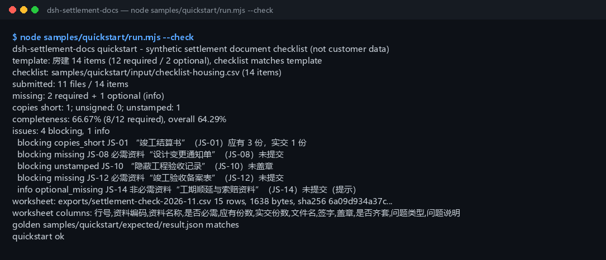

<div align="center">

<picture>
  <source media="(prefers-color-scheme: dark)" srcset="docs/assets/dsh-settlement-docs-hero-en-dark.webp">
  
</picture>

# dsh-settlement-docs

**Check a construction final-settlement document checklist against what was actually submitted — missing documents, short copies, missing signatures/stamps, optional documents absent → a review worksheet CSV.**

A purely local completeness checker for DeepSeek Harness: read one checklist CSV and one actual-submission CSV, align them item by item, compute the completeness rate, and export a reviewable worksheet that opens cleanly in Excel — file names, copy counts and signature/stamp markers only; no file contents are read, and nothing is uploaded, networked or sent to a model.

[Install](#three-step-setup) · [Configuration](#configuration) · [FAQ](#faq) · [简体中文](README.md) · [English](README.en.md) · [Español](README.es.md) · [Português](README.pt.md) · [हिन्दी](README.hi.md)

[](LICENSE)
[](#compatibility)
[](https://www.npmjs.com/package/dsh-settlement-docs)
[](https://github.com/PerryLink/dsh-settlement-docs/actions/workflows/ci.yml)
[](#compatibility)

[](https://github.com/PerryLink/dsh-settlement-docs/stargazers)
[](https://www.npmjs.com/package/dsh-settlement-docs)

```sh
dsh plugin --profile <profile> add dsh-settlement-docs
```

</div>

<sub>Community plugin, not affiliated with DeepSeek. Canonical repository: <https://github.com/PerryLink/dsh-settlement-docs>. Status: alpha / public-synthetic / partial / not counted / not GA — no customer data, no customer evidence, and no production-readiness claim.</sub>

## What it is

Align “which final-settlement documents should have been handed over” with “what actually arrived”: list missing documents, short copies, missing signatures/stamps and optional documents absent, compute a completeness rate, then export a reviewable worksheet CSV — it reads only file names, copy counts and signature/stamp markers from the CSV, never the file contents, and it never uploads, networks or calls a model.

- **Fits:** settlement document controllers at a main contractor, subcontractor, owner or supervisor doing a pre-submission completeness self-check; a fixed project type (housing / municipal / decoration) with a checklist of tens of items; needing one list of what is missing, how many copies short, and which stamp is absent; needing a worksheet that opens cleanly in Excel.
- **Does not fit:** replacing archive acceptance, completion filing or legal advice; OCR of scanned PDFs/images (CSV only, file contents are never read); judging whether a document is genuine or a signature is authorised; multi-project / multi-section ledgers (one project checklist per run).

<picture>
  <source media="(prefers-color-scheme: dark)" srcset="docs/assets/dsh-settlement-docs-flow-v5-dark.svg">
  
</picture>

## Three-step setup

1. **Install** (pick one channel):

   ```sh
   # npm channel (recommended, published releases)
   dsh plugin --profile <profile> add dsh-settlement-docs
   # git channel (latest main; equivalent to git+https://github.com/PerryLink/dsh-settlement-docs.git)
   dsh plugin --profile <profile> add github:PerryLink/dsh-settlement-docs
   # tarball channel: pnpm pack in this repo, then
   dsh plugin --profile <profile> add ./dsh-settlement-docs-<version>.tgz
   ```

2. **Minimal config** (no Config keys at all; `cordis.patch.yml` only inserts this row):

   ```yaml
   - insert:
       - id: dsh-settlement-docs
         name: 'dsh-settlement-docs'
   ```

3. **Verify it mounts**:

   ```sh
   dsh --profile <profile> --dump-config | grep dsh-settlement-docs
   node samples/quickstart/run.mjs --check
   ```

**Uninstall**: `dsh plugin --profile <profile> remove dsh-settlement-docs` (or remove the row from the profile patch).

## Core capabilities

Tool names are stable API; tool descriptions stay in English to match runtime output.

| Tool | Purpose | Risk |
|---|---|---|
| `settlement.template` | Generate the built-in checklist template CSV for a project type (housing / municipal / decoration, 12+ items each); returns text and counts | R0 |
| `settlement.check` | Compare checklist vs submission: missing, short copies, missing signature/stamp, optional absent, completeness rate | R0 |
| `settlement.export` | Re-run the check and write the worksheet CSV (UTF-8 BOM); returns path, rows, bytes and sha256 | R1 local write |

- **Checklist-driven** — one checklist CSV and one submission CSV are aligned by document code; a code that does not match stops the run instead of silently counting a missing document as submitted.
- **Four issue types + completeness rate** — missing, short copies, unsigned and unstamped are counted separately; the required completeness rate covers required documents only, and a second overall rate includes optional documents.
- **Optional documents never block** — a missing optional document is reported as `optional_missing`, does not lower the required rate, and still appears in the issue list and the worksheet.
- **Reviewable worksheet** — one row per checklist line with issue type and message; UTF-8 BOM so Excel opens it cleanly, and the export result carries a sha256.
- **Purely local** — no network, no model call, no upload; source CSVs are read-only and never modified.

## Input

- **Checklist CSV:** UTF-8, header `code,name,required_copies,required` (the equivalent Chinese column names are also accepted). Column order is free and extra columns are ignored.
  - `required_copies` is a positive integer; `required` is yes/no (the Chinese markers are also accepted).
  - Every document code appears once; the checklist cannot be empty (header-only is also rejected).
- **Actual-submission CSV:** UTF-8, header `code,filename,copies,signed,stamped` (the Chinese header is also accepted).
  - `copies` is a non-negative integer; `signed`/`stamped` are yes/no (also accepts several Chinese markers, `true`, `0`, and blank means “no”).
  - Every code appears once. A header-only file means “nothing submitted” and is valid (0% completeness).

Accepted Chinese headers (also valid):

```text
资料编码,资料名称,应有份数,是否必需
资料编码,文件名,份数,签字,盖章
```

- **Project templates:** housing (14 items / 12 required), municipal (13 / 12), decoration (12 / 11).
- **Sample:** `samples/quickstart/input/checklist-housing.csv` (14 items, byte-identical to the housing template) and `submitted-2026-11.csv` (11 files). Synthetic only (codes, file names and copy counts are invented).

## Output

- `settlement.template`: built-in checklist template CSV text, project type, total/required/optional item counts, bytes and sha256. **No file is written.**
- `settlement.check`: `summary` (checklist items, submitted, missing, short copies, unsigned, unstamped, optional missing, completeness rate, blocking/info counts), an `issues` list in checklist order, and merged per-item `items`.
- `settlement.export`: review worksheet CSV (UTF-8 BOM, opens cleanly in Excel), one row per checklist line with issue type and message; written to `$DSH_HOME/dsh-settlement-docs/exports/`; returns path, rows, bytes and sha256. Without `filename` it writes `settlement-check.csv` (same-name files are overwritten).
- The source CSVs are never modified; no upload, no network, no model call.

### Check rules

1. **Missing required** — a required code absent from the submission → `missing`, blocking.
2. **Optional absent** — an optional code absent → `optional_missing`, info only; does not lower the required rate.
3. **Short copies** — `submitted < required` → `copies_short`; equal or more is fine.
4. **Unsigned / unstamped** — `signed` or `stamped` is “no”/blank → `unsigned` / `unstamped`; both can hit one line.
5. **Unknown code** — a submitted code not in the checklist → `E_SETTLEMENT_UNKNOWN_CODE`; the whole check stops.
6. **Duplicate code** — the same code twice in either list → `E_SETTLEMENT_DUP_CODE`.
7. **Complete** — submitted + enough copies + signed + stamped; `items[].complete=true` only then.
8. **Empty checklist** — empty or header-only → `E_SETTLEMENT_EMPTY`. A header-only submission is valid (= nothing submitted).

## Example

Paste this one line into the agent:

```text
帮我把这份竣工结算资料核对一下：缺哪些、份数够不够、有没有没签字的，再把核对表导出来。
```

Reproduce the bundled sample and compare with the golden file:

```sh
node samples/quickstart/run.mjs --check
```



This is a real run: a 14-item housing checklist (12 required / 2 optional) against 11 submitted files — **2 required + 1 optional missing**, **1 short copy** (settlement book 1/3), **1 missing stamp** (concealed-works record), no missing signatures. The completeness rate is **66.67% (8/12 required)** and **64.29% (9/14) overall**, with **4 blocking + 1 info** issues and a 15-row worksheet (1,638 bytes). `samples/quickstart/expected/result.json` is the real stdout of `node samples/quickstart/run.mjs --json`, not hand-written; the raw log is [`docs/assets/quickstart.log`](docs/assets/quickstart.log).

## Configuration

This plugin has **no Config keys** — it is fully usable once mounted, and every tunable lives on the three tools' call arguments:

| Tool | Parameter | Required | Meaning |
|---|---|---|---|
| `settlement.template` | `project_type` | yes | Project type: `housing`, `municipal` or `decoration` (the Chinese names are also accepted) |
| `settlement.check` | `checklist_csv` | yes | Checklist CSV text (the tool surface takes the file content directly) |
| `settlement.check` | `submission_csv` | yes | Actual-submission CSV text |
| `settlement.export` | `checklist_csv` | yes | Same as above |
| `settlement.export` | `submission_csv` | yes | Same as above |
| `settlement.export` | `filename` | no | Export file name, `[A-Za-z0-9._-]` only, at most 120 characters; defaults to `settlement-check.csv` |

Call example (tool surface):

```sh
# 1) generate a template (tool surface)
#    settlement.template({ project_type: "housing" })

# 2) check (tool surface)
#    settlement.check({ checklist_csv, submission_csv })

# 3) export the worksheet (tool surface)
#    settlement.export({ checklist_csv, submission_csv, filename: "settlement-check-2026-11.csv" })
```

For tests, the `DSH_SETTLEMENT_DOCS_HOME` environment variable overrides the local write root; by default it is exactly `$DSH_HOME/dsh-settlement-docs`.

## FAQ

<details>
<summary>How is the completeness rate computed?</summary>

**Rate = complete required documents ÷ all required documents**, rounded to 2 decimals. A document is complete only when it is submitted, has enough copies, is signed and is stamped. `summary.overall_rate_pct` is the same calculation including optional documents; the worksheet has a per-line completeness column.

</details>

<details>
<summary>Why doesn't a missing optional document block?</summary>

“Optional” means it can be absent at submission, so it produces an info-level issue and does not lower the required completeness rate; it is still listed in `issues` and in the worksheet as `optional_missing`. A submitted optional document with a copy/signature/stamp defect is also reported at info level.

</details>

<details>
<summary>Why does an unknown submission code abort the check?</summary>

Silently ignoring a mismatched code would inflate the rate — a typo of `JS-08` as `JS-09` would mark `JS-09` as received while `JS-08` still looks missing. `E_SETTLEMENT_UNKNOWN_CODE` stops the run and lists every unknown code. A duplicate code in either list is `E_SETTLEMENT_DUP_CODE`.

</details>

<details>
<summary>What happens when the signature or stamp cell is blank?</summary>

A blank cell means “no” and raises the same issue as an explicit no. The **column itself cannot be missing**: an absent `signed` or `stamped` header is `E_SETTLEMENT_CSV_ROW`, because that usually means the header was copied wrong.

</details>

<details>
<summary>Does it modify or upload my CSV? Can it read Excel directly?</summary>

It never modifies, uploads or sends the CSV over the network. Save the sheet as **CSV UTF-8** first. Excel-written UTF-8 CSVs with a BOM are accepted.

</details>

<details>
<summary>Can the built-in template be used as the official checklist?</summary>

Not as a statutory register. It is a **minimal starting point** (housing 14, municipal 13, decoration 12) covering the most common settlement-submission documents; local filing, special acceptance and contract requirements usually add more. Treat it as a skeleton and follow the contract and local archive rules.

</details>

## Permissions

Read: the checklist CSV and actual-submission CSV the user names (sample: `samples/quickstart/input/`); nothing else.
Write: `$DSH_HOME/dsh-settlement-docs/exports/` (review worksheet CSV) only; source files are not modified.
Network: no.
External systems: none.

`settlement.template` and `settlement.check` are **R0** (read-only; the template lives in memory). `settlement.export` is **R1** (local write under `$DSH_HOME/dsh-settlement-docs`). `DSH_SETTLEMENT_DOCS_HOME` can override the local write root for tests; by default it is exactly `$DSH_HOME/dsh-settlement-docs`.

## Acceptance evidence

Public/synthetic fixtures live in `samples/quickstart/`; `ACCEPTANCE.csv` records the checks, and every row except the quickstart row is `counted=false`.

| req_id | metric | threshold | actual | pass | source | counted |
|---|---|---|---|---|---|---|
| SD-A05 | missing documents | 2 required + 1 optional | required=2 optional=1 | true | public/synthetic | false |
| SD-A08 | completeness rate | 66.67% (8/12) | 66.67% (8/12) | true | public/synthetic | false |
| PS1-QS01 | quickstart golden | 1/1 | 1 | true | synthetic/quickstart | true |

*Fixture-backed acceptance rows, not a customer run; no output was invented.*

## Boundaries and known limits

- **Completeness only, not content**: it does not verify amounts, whether a variation is valid, signatory authority or document authenticity.
- **One line per document**: merge split files into one code; duplicate codes fail with `E_SETTLEMENT_DUP_CODE`.
- **No PDF/image reading**: only filename, copy count and signature/stamp markers in the CSV; no OCR.
- **Template is not a statutory register**: follow the contract and local filing requirements.
- **One project/section per run**: split multi-section projects into separate checklists.
- Public/synthetic fixtures only; alpha/partial, not counted, no GA or production-readiness claim.

## Compatibility

| Dimension | Status |
|---|---|
| Harness | `dsh >=0.2.1-rc.3 <0.4.0` |
| Node | `>=24.9.0 <25` |
| Platforms | All; local files only |
| Data | No network, no model call, no upload |

## Ecosystem & quality

- [npm package page](https://www.npmjs.com/package/dsh-settlement-docs) (version and downloads)
- [CI workflow](https://github.com/PerryLink/dsh-settlement-docs/actions/workflows/ci.yml) (`ci.yml`: build, lint, typecheck, tests, acceptance gate)
- [Troubleshooting](TROUBLESHOOTING.md) (5 error codes written as symptom / cause / action)
- [Ecosystem knowledge base](https://perrylink.github.io/dsh-plugin-guide/) — plugin development guide · selection data · maintenance criteria

## Related projects

- [dsh-progress-payment](https://github.com/PerryLink/dsh-progress-payment) (contract-baseline progress payment)
- [dsh-contract-pack](https://github.com/PerryLink/dsh-contract-pack) (contract clauses and registers)
- [dsh-construction-pack](https://github.com/PerryLink/dsh-construction-pack) (construction scenario bundle)

## Development

```sh
pnpm install --frozen-lockfile
pnpm build && pnpm lint && pnpm typecheck
node --test test/*.test.mjs
node scripts/gate.mjs
```

Current version `0.1.0` with 72 tests passing (`node --test test/*.test.mjs`). The release gate `node scripts/gate.mjs` = metadata lint + every public acceptance row passing + the quickstart golden row present. The opening banner and structure diagram are generated by [`scripts/gen-readme-assets.py`](scripts/gen-readme-assets.py) (Pillow renders the 1440×576 light/dark webp, a hand-written SVG renders the 1100×660 structure diagram; every number is copied from `samples/quickstart/expected/result.json`; no benchmark data exists, so no evidence chart is emitted) and can be re-run safely; `docs/assets/quickstart.png` is a real run capture kept together with `docs/assets/quickstart.log`.

Topics: `dsh`, `dsh-plugin`, `deepseek-harness`, `settlement`, `completion-documents`, `construction`, `document-checklist`, `csv`, `perrylink`

## Family & thanks

This project is part of the DeepSeek Harness plugin family from [PerryLink](https://github.com/PerryLink) (all Apache-2.0). If it is useful, **a star helps the next person find it** — nothing is gated behind it.

- [@PerryLink](https://github.com/PerryLink) — creator and maintainer: the settlement-document checking engine, CSV parsing and completeness rate, the three tool surfaces, the quickstart golden sample, the troubleshooting guide and the five-language docs.

## License

[LICENSE](LICENSE) (Apache License 2.0) © 2026 dsh-settlement-docs contributors. See also `NOTICE` and `THIRD-PARTY-NOTICES`.

<p align="center"><sub>Apache-2.0 · Community plugin, not affiliated with DeepSeek.</sub></p>
