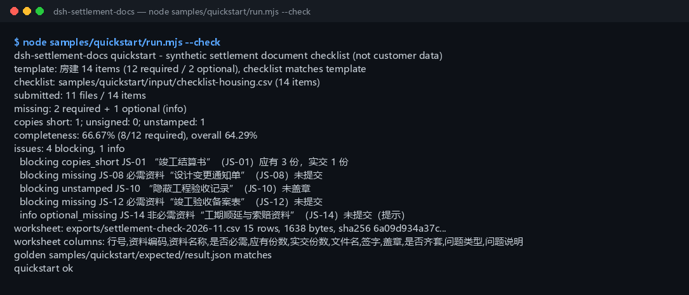

<div align="center">

<picture>
  <source media="(prefers-color-scheme: dark)" srcset="docs/assets/dsh-settlement-docs-hero-en-dark.webp">
  
</picture>

# dsh-settlement-docs

**Comprueba una lista de documentos de liquidación final de obra contra lo realmente entregado: documentos faltantes, copias insuficientes, firmas/sellos ausentes, documentos opcionales no entregados → CSV de hoja de revisión.**

Una herramienta de verificación de completitud puramente local para DeepSeek Harness: lee un CSV de lista de documentos y un CSV de entrega real, los alinea partida por partida, calcula la tasa de completitud y exporta una hoja de revisión que abre limpia en Excel — solo nombres de archivo, número de copias y marcas de firma/sello; no lee el contenido de los archivos y no sube, no se conecta ni llama a un modelo.

[Instalar](#instalación-en-tres-pasos) · [Configuración](#configuración) · [FAQ](#faq) · [简体中文](README.md) · [English](README.en.md) · [Español](README.es.md) · [Português](README.pt.md) · [हिन्दी](README.hi.md)

[](LICENSE)
[](#compatibilidad)
[](https://www.npmjs.com/package/dsh-settlement-docs)
[](https://github.com/PerryLink/dsh-settlement-docs/actions/workflows/ci.yml)
[](#compatibilidad)

[](https://github.com/PerryLink/dsh-settlement-docs/stargazers)
[](https://www.npmjs.com/package/dsh-settlement-docs)

```sh
dsh plugin --profile <profile> add dsh-settlement-docs
```

</div>

<sub>Plugin de la comunidad, no afiliado a DeepSeek. Repositorio canónico: <https://github.com/PerryLink/dsh-settlement-docs>. Estado: alpha / público-sintético / partial / not counted / no GA — sin datos de clientes, sin evidencia de clientes y sin declaración de disponibilidad para producción.</sub>

## Qué es

Alinea “qué documentos de liquidación final deberían haberse entregado” con “qué llegó realmente”: enumera documentos faltantes, copias insuficientes, firmas/sellos ausentes y documentos opcionales no entregados, calcula una tasa de completitud y exporta una hoja de revisión CSV — solo lee nombres de archivo, número de copias y marcas de firma/sello del CSV, nunca el contenido de los archivos, y no sube, no se conecta ni llama a un modelo.

- **Encaja:** responsables de documentación de liquidación en contratista principal, subcontratista, propiedad o supervisión que hacen una autocomprobación de completitud antes de presentar; un tipo de obra fijo (vivienda / municipal / decoración) con una lista de decenas de partidas; necesitar una sola lista de qué falta, cuántas copias faltan y qué sello falta; necesitar una hoja que abra limpia en Excel.
- **No encaja:** sustituir la aceptación de archivo, la inscripción de terminación o el asesoramiento legal; OCR de PDF/escaneos/imágenes (solo CSV, nunca se lee el contenido); juzgar si un documento es auténtico o si una firma está autorizada; libros de varios proyectos o secciones (una lista por ejecución).

<picture>
  <source media="(prefers-color-scheme: dark)" srcset="docs/assets/dsh-settlement-docs-flow-v5-dark.svg">
  
</picture>

## Instalación en tres pasos

1. **Instalar** (elige un canal):

   ```sh
   # canal npm (recomendado, versiones publicadas)
   dsh plugin --profile <profile> add dsh-settlement-docs
   # canal git (último main; equivale a git+https://github.com/PerryLink/dsh-settlement-docs.git)
   dsh plugin --profile <profile> add github:PerryLink/dsh-settlement-docs
   # canal tarball: pnpm pack en este repo y después
   dsh plugin --profile <profile> add ./dsh-settlement-docs-<version>.tgz
   ```

2. **Configuración mínima** (no hay ninguna clave Config; `cordis.patch.yml` solo inserta esta fila):

   ```yaml
   - insert:
       - id: dsh-settlement-docs
         name: 'dsh-settlement-docs'
   ```

3. **Verificar que se monta**:

   ```sh
   dsh --profile <profile> --dump-config | grep dsh-settlement-docs
   node samples/quickstart/run.mjs --check
   ```

**Desinstalar**: `dsh plugin --profile <profile> remove dsh-settlement-docs` (o elimina la fila del patch del perfil).

## Capacidades clave

Los nombres de las herramientas son API estable; las descripciones se mantienen en inglés para coincidir con la salida del runtime.

| Herramienta | Uso | Riesgo |
|---|---|---|
| `settlement.template` | Genera el CSV de plantilla de lista integrada para un tipo de obra (vivienda / municipal / decoración, 12+ partidas cada uno); devuelve texto y recuentos | R0 |
| `settlement.check` | Compara lista y entrega: faltantes, copias insuficientes, firma/sello ausentes, opcionales no entregados, tasa de completitud | R0 |
| `settlement.export` | Repite la comprobación y escribe el CSV de hoja de revisión (UTF-8 BOM); devuelve ruta, filas, bytes y sha256 | R1 escritura local |

- **Guiado por la lista** — un CSV de lista y un CSV de entrega se alinean por código de documento; un código que no coincide detiene la ejecución en vez de contar en silencio un documento faltante como entregado.
- **Cuatro tipos de problema + tasa** — faltantes, copias insuficientes, sin firma y sin sello se cuentan por separado; la tasa de completitud exigida cubre solo documentos obligatorios, y una segunda tasa global incluye los opcionales.
- **Los opcionales nunca bloquean** — un documento opcional ausente se registra como `optional_missing`, no baja la tasa exigida y aun así aparece en la lista de problemas y en la hoja.
- **Hoja revisable** — una fila por partida con tipo y mensaje del problema; UTF-8 BOM para que Excel la abra limpia, y el resultado de la exportación lleva sha256.
- **Puramente local** — sin red, sin llamada al modelo, sin subida; los CSV de origen son de solo lectura y nunca se modifican.

## Entrada

- **CSV de lista de documentos:** UTF-8, cabecera `code,name,required_copies,required` (también se aceptan los nombres de columna equivalentes en chino). El orden de columnas es libre y las columnas extra se ignoran.
  - `required_copies` es un entero positivo; `required` es sí/no (también se aceptan los marcadores chinos).
  - Cada código de documento aparece una vez; la lista no puede estar vacía (solo cabecera también se rechaza).
- **CSV de entrega real:** UTF-8, cabecera `code,filename,copies,signed,stamped` (también se acepta la cabecera china).
  - `copies` es un entero no negativo; `signed`/`stamped` son sí/no (también acepta varios marcadores chinos, `true`, `0`; una celda vacía significa “no”).
  - Cada código aparece una vez. Un archivo solo con cabecera significa “no se entregó nada” y es válido (0% de completitud).
- **Plantillas de tipo de obra:** vivienda (14 partidas / 12 obligatorias), municipal (13 / 12), decoración (12 / 11).
- **Muestra:** `samples/quickstart/input/checklist-housing.csv` (14 partidas, idéntico byte a byte a la plantilla de vivienda) y `submitted-2026-11.csv` (11 archivos). Solo sintéticos (códigos, nombres de archivo y copias inventados).

## Salida

- `settlement.template`: texto CSV de la plantilla de lista integrada, tipo de obra, total de partidas, obligatorias/opcionales, bytes y sha256. **No escribe ningún archivo.**
- `settlement.check`: `summary` (partidas de la lista, entregadas, faltantes, copias insuficientes, sin firma, sin sello, opcionales ausentes, tasa de completitud, recuentos de bloqueo/info), una lista `issues` en orden de la lista y `items` fusionados por partida.
- `settlement.export`: CSV de hoja de revisión (UTF-8 BOM, abre limpio en Excel), una fila por partida con tipo y mensaje del problema; se escribe en `$DSH_HOME/dsh-settlement-docs/exports/`; devuelve ruta, filas, bytes y sha256. Sin `filename` escribe `settlement-check.csv` (los archivos con el mismo nombre se sobrescriben).
- Los CSV de origen nunca se modifican; sin subida, sin red, sin llamada al modelo.

### Reglas de verificación

1. **Faltante obligatorio** — un código obligatorio ausente en la entrega → `missing`, bloqueante.
2. **Opcional ausente** — un código opcional ausente → `optional_missing`, solo informativo; no baja la tasa exigida.
3. **Copias insuficientes** — `entregadas < exigidas` → `copies_short`; igual o más está bien.
4. **Sin firma / sin sello** — `signed` o `stamped` es “no”/vacío → `unsigned` / `unstamped`; una misma partida puede tener ambos.
5. **Código desconocido** — un código entregado que no está en la lista → `E_SETTLEMENT_UNKNOWN_CODE`; se detiene toda la comprobación.
6. **Código duplicado** — el mismo código dos veces en cualquiera de las listas → `E_SETTLEMENT_DUP_CODE`.
7. **Completo** — entregado + copias suficientes + firmado + sellado; `items[].complete=true` solo entonces.
8. **Lista vacía** — vacía o solo con cabecera → `E_SETTLEMENT_EMPTY`. Una entrega solo con cabecera es válida (= no se entregó nada).

## Ejemplo

Copia esta línea en el agente:

```text
帮我把这份竣工结算资料核对一下：缺哪些、份数够不够、有没有没签字的，再把核对表导出来。
```

Reproduce la muestra incluida y compara con el archivo dorado:

```sh
node samples/quickstart/run.mjs --check
```



Es una ejecución real: lista de vivienda de 14 partidas (12 obligatorias / 2 opcionales) contra 11 archivos entregados — **2 obligatorios + 1 opcional faltantes**, **1 copia insuficiente** (libro de liquidación 1/3), **1 sello ausente** (registro de obras ocultas), ninguna firma ausente. La tasa de completitud es **66,67% (8/12 obligatorias)** y **64,29% (9/14) global**, con **4 bloqueantes + 1 informativo** y una hoja de 15 filas (1.638 bytes). `samples/quickstart/expected/result.json` es la salida real de `node samples/quickstart/run.mjs --json`, no escrita a mano; el registro bruto está en [`docs/assets/quickstart.log`](docs/assets/quickstart.log).

## Configuración

Este plugin **no tiene claves Config** — queda totalmente usable al montarse, y todo lo ajustable vive en los argumentos de llamada de las tres herramientas:

| Herramienta | Parámetro | Obligatorio | Significado |
|---|---|---|---|
| `settlement.template` | `project_type` | sí | Tipo de obra: `housing`, `municipal` o `decoration` (también se aceptan los nombres chinos) |
| `settlement.check` | `checklist_csv` | sí | Texto del CSV de lista (la superficie de herramienta recibe el contenido del archivo) |
| `settlement.check` | `submission_csv` | sí | Texto del CSV de entrega real |
| `settlement.export` | `checklist_csv` | sí | Igual que arriba |
| `settlement.export` | `submission_csv` | sí | Igual que arriba |
| `settlement.export` | `filename` | no | Nombre del archivo de exportación, solo `[A-Za-z0-9._-]`, máximo 120 caracteres; por defecto `settlement-check.csv` |

Ejemplo de llamada (superficie de herramienta):

```sh
# 1) generar una plantilla (superficie de herramienta)
#    settlement.template({ project_type: "housing" })

# 2) comprobar (superficie de herramienta)
#    settlement.check({ checklist_csv, submission_csv })

# 3) exportar la hoja (superficie de herramienta)
#    settlement.export({ checklist_csv, submission_csv, filename: "settlement-check-2026-11.csv" })
```

Para pruebas, la variable de entorno `DSH_SETTLEMENT_DOCS_HOME` sobrescribe la raíz de escritura local; por defecto es exactamente `$DSH_HOME/dsh-settlement-docs`.

## FAQ

<details>
<summary>¿Cómo se calcula la tasa de completitud?</summary>

**Tasa = documentos obligatorios completos ÷ total de documentos obligatorios**, redondeada a 2 decimales. Un documento solo está completo cuando se entregó, tiene copias suficientes, está firmado y está sellado. `summary.overall_rate_pct` es el mismo cálculo incluyendo los opcionales; la hoja tiene una columna de completitud por fila.

</details>

<details>
<summary>¿Por qué un documento opcional ausente no bloquea?</summary>

“Opcional” significa que puede faltar en la entrega, así que genera un problema informativo y no baja la tasa exigida; aun así aparece en `issues` y en la hoja como `optional_missing`. Un documento opcional entregado con defecto de copias/firma/sello también se informa a nivel informativo.

</details>

<details>
<summary>¿Por qué un código desconocido aborta la comprobación?</summary>

Ignorar en silencio un código que no coincide inflaría la tasa — un error tipográfico de `JS-08` como `JS-09` marcaría `JS-09` como recibido mientras `JS-08` seguiría faltando. `E_SETTLEMENT_UNKNOWN_CODE` detiene la ejecución y enumera todos los códigos desconocidos. Un código duplicado en cualquiera de las listas es `E_SETTLEMENT_DUP_CODE`.

</details>

<details>
<summary>¿Qué pasa si la celda de firma o sello está vacía?</summary>

Una celda vacía significa “no” y produce el mismo problema que un no explícito. **La columna no puede faltar**: una cabecera `signed` o `stamped` ausente es `E_SETTLEMENT_CSV_ROW`, porque normalmente significa que la cabecera se copió mal.

</details>

<details>
<summary>¿Modifica o sube mi CSV? ¿Puede leer Excel directamente?</summary>

Nunca modifica, sube ni envía el CSV por la red. Guarda primero la hoja como **CSV UTF-8**. Los CSV UTF-8 con BOM escritos por Excel se aceptan.

</details>

<details>
<summary>¿Puedo usar la plantilla integrada como lista oficial?</summary>

No como registro legal. Es un **punto de partida mínimo** (vivienda 14, municipal 13, decoración 12) que cubre los documentos de entrega de liquidación más habituales; la inscripción local, la aceptación especial y los requisitos contractuales suelen añadir más. Trátala como esqueleto y sigue el contrato y las normas de archivo locales.

</details>

## Permisos

Lectura: los CSV de lista y de entrega indicados por el usuario (muestra: `samples/quickstart/input/`); nada más.
Escritura: solo `$DSH_HOME/dsh-settlement-docs/exports/` (CSV de hoja de revisión); los archivos de origen no se modifican.
Red: no.
Sistemas externos: ninguno.

`settlement.template` y `settlement.check` son **R0** (solo lectura; la plantilla vive en memoria). `settlement.export` es **R1** (escritura local bajo `$DSH_HOME/dsh-settlement-docs`). `DSH_SETTLEMENT_DOCS_HOME` puede sobrescribir la raíz de escritura local para pruebas; por defecto es exactamente `$DSH_HOME/dsh-settlement-docs`.

## Evidencia de aceptación

Los fixtures públicos/sintéticos están en `samples/quickstart/`; `ACCEPTANCE.csv` registra las comprobaciones y todas las filas salvo la del quickstart son `counted=false`.

| req_id | metric | threshold | actual | pass | source | counted |
|---|---|---|---|---|---|---|
| SD-A05 | documentos faltantes | 2 obligatorios + 1 opcional | required=2 optional=1 | true | public/synthetic | false |
| SD-A08 | tasa de completitud | 66,67% (8/12) | 66,67% (8/12) | true | public/synthetic | false |
| PS1-QS01 | dorado del quickstart | 1/1 | 1 | true | synthetic/quickstart | true |

*Filas de aceptación respaldadas por fixtures, no una ejecución de cliente; no se inventó ninguna salida.*

## Límites y restricciones conocidas

- **Solo completitud, no contenido**: no verifica importes, si una variación es válida, la autoridad del firmante ni la autenticidad del documento.
- **Una línea por documento**: fusiona los archivos divididos en un solo código; los códigos duplicados fallan con `E_SETTLEMENT_DUP_CODE`.
- **Sin lectura de PDF/imágenes**: solo nombre de archivo, número de copias y marcas de firma/sello en el CSV; sin OCR.
- **La plantilla no es un registro legal**: sigue el contrato y los requisitos de archivo locales.
- **Un proyecto/sección por ejecución**: divide los proyectos con varias secciones en listas separadas.
- Solo fixtures públicos/sintéticos; alpha/partial, not counted, sin declaración de GA ni de disponibilidad para producción.

## Compatibilidad

| Dimensión | Estado |
|---|---|
| Harness | `dsh >=0.2.1-rc.3 <0.4.0` |
| Node | `>=24.9.0 <25` |
| Plataformas | Todas; solo archivos locales |
| Datos | Sin red, sin llamada al modelo, sin subida |

## Ecosistema y calidad

- [Página del paquete npm](https://www.npmjs.com/package/dsh-settlement-docs) (versión y descargas)
- [Workflow de CI](https://github.com/PerryLink/dsh-settlement-docs/actions/workflows/ci.yml) (`ci.yml`: build, lint, typecheck, pruebas, puerta de aceptación)
- [Solución de problemas](TROUBLESHOOTING.md) (5 códigos de error escritos como síntoma / causa / acción)
- [Base de conocimiento del ecosistema](https://perrylink.github.io/dsh-plugin-guide/): guía de desarrollo de plugins · datos de selección · criterios de mantenimiento

## Proyectos relacionados

- [dsh-progress-payment](https://github.com/PerryLink/dsh-progress-payment) (pago por avance con base contractual)
- [dsh-contract-pack](https://github.com/PerryLink/dsh-contract-pack) (cláusulas y registros de contrato)
- [dsh-construction-pack](https://github.com/PerryLink/dsh-construction-pack) (paquete de escenarios de construcción)

## Desarrollo

```sh
pnpm install --frozen-lockfile
pnpm build && pnpm lint && pnpm typecheck
node --test test/*.test.mjs
node scripts/gate.mjs
```

Versión actual `0.1.0`, 72 pruebas en verde (`node --test test/*.test.mjs`). La puerta de publicación `node scripts/gate.mjs` = lint de metadatos + todas las filas públicas de aceptación en verde + la fila dorada del quickstart presente. El banner inicial y el diagrama de estructura los genera [`scripts/gen-readme-assets.py`](scripts/gen-readme-assets.py) (Pillow produce el webp claro/oscuro de 1440×576, un SVG escrito a mano produce el diagrama de 1100×660; cada cifra se copia de `samples/quickstart/expected/result.json`; no hay datos de benchmark, así que no se emite gráfico de evidencia) y se puede volver a ejecutar; `docs/assets/quickstart.png` es una captura real conservada junto a `docs/assets/quickstart.log`.

Topics: `dsh`, `dsh-plugin`, `deepseek-harness`, `settlement`, `completion-documents`, `construction`, `document-checklist`, `csv`, `perrylink`

## Familia y agradecimientos

Este proyecto forma parte de la familia de plugins de DeepSeek Harness de [PerryLink](https://github.com/PerryLink) (todos Apache-2.0). Si te resulta útil, **una estrella ayuda a que la siguiente persona lo encuentre** — no desbloquea nada.

- [@PerryLink](https://github.com/PerryLink) — creador y mantenedor: el motor de comprobación de documentos de liquidación, el análisis CSV y la tasa de completitud, las tres superficies de herramienta, la muestra dorada del quickstart, la guía de solución de problemas y la documentación en cinco idiomas.

## Licencia

[LICENSE](LICENSE) (Apache License 2.0) © 2026 dsh-settlement-docs contributors. Ver también `NOTICE` y `THIRD-PARTY-NOTICES`.

<p align="center"><sub>Apache-2.0 · Plugin de la comunidad, no afiliado a DeepSeek.</sub></p>
