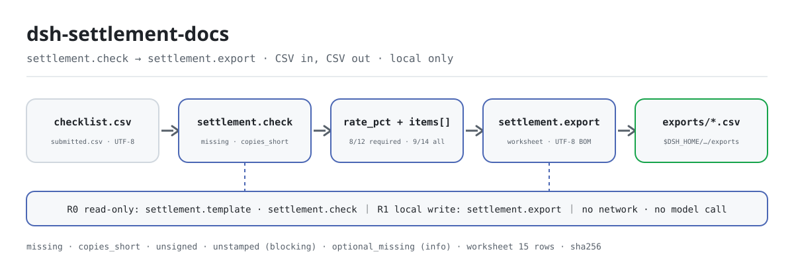
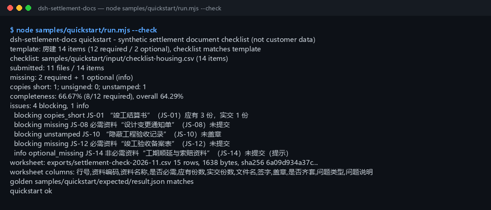

<div align="center">

<picture>
  <source media="(prefers-color-scheme: dark)" srcset="docs/assets/dsh-settlement-docs-flow-dark.svg">
  
</picture>

# dsh-settlement-docs

**निर्माण अंतिम-निपटान दस्तावेज़ चेकलिस्ट की वास्तव में जमा किए गए दस्तावेज़ों से तुलना: गुम दस्तावेज़, कम प्रतियाँ, अनुपस्थित हस्ताक्षर/मुहर, वैकल्पिक दस्तावेज़ अनुपस्थित → समीक्षा वर्कशीट CSV।**

DeepSeek Harness के लिए पूरी तरह लोकल पूर्णता जाँच उपकरण: एक चेकलिस्ट CSV और एक वास्तविक जमा CSV पढ़ता है, दोनों को मद-दर-मद मिलाता है, पूर्णता दर निकालता है और एक ऐसी समीक्षा वर्कशीट निर्यात करता है जो Excel में साफ़ खुलती है — केवल फ़ाइल नाम, प्रतियों की संख्या और हस्ताक्षर/मुहर के चिह्न; फ़ाइल की सामग्री नहीं पढ़ी जाती, कुछ अपलोड नहीं होता, नेटवर्क नहीं होता और मॉडल नहीं बुलाया जाता।

[इंस्टॉल](#तीन-चरणों-में-शुरुआत) · [कॉन्फ़िगरेशन](#कॉन्फ़िगरेशन) · [FAQ](#faq) · [简体中文](README.md) · [English](README.en.md) · [Español](README.es.md) · [Português](README.pt.md) · [हिन्दी](README.hi.md)

[](LICENSE)
[](#संगतता)
[](https://www.npmjs.com/package/dsh-settlement-docs)
[](https://github.com/PerryLink/dsh-settlement-docs/actions/workflows/ci.yml)
[](#संगतता)

[](https://github.com/PerryLink/dsh-settlement-docs/stargazers)
[](https://www.npmjs.com/package/dsh-settlement-docs)

```sh
dsh plugin --profile <profile> add dsh-settlement-docs
```

</div>

<sub>सामुदायिक प्लगइन, DeepSeek से असंबद्ध। एकमात्र आधिकारिक रिपॉज़िटरी: <https://github.com/PerryLink/dsh-settlement-docs>। स्थिति: alpha / सार्वजनिक-सिंथेटिक / partial / not counted / GA नहीं — ग्राहक डेटा नहीं, ग्राहक प्रमाण नहीं, और उत्पादन-तैयारी का दावा नहीं।</sub>

## यह क्या है

“कौन से अंतिम-निपटान दस्तावेज़ सौंपे जाने चाहिए थे” और “वास्तव में क्या आया” को मद-दर-मद मिलाता है: गुम दस्तावेज़, कम प्रतियाँ, बिना हस्ताक्षर/बिना मुहर और अनुपस्थित वैकल्पिक दस्तावेज़ की सूची बनाता है, पूर्णता दर निकालता है, और फिर एक समीक्षा-योग्य वर्कशीट CSV निर्यात करता है — CSV से केवल फ़ाइल नाम, प्रतियों की संख्या और हस्ताक्षर/मुहर के चिह्न पढ़ता है, फ़ाइल की सामग्री कभी नहीं, और कुछ अपलोड, नेटवर्क या मॉडल कॉल नहीं करता।

- **किसके लिए उपयुक्त:** मुख्य ठेकेदार, उप-ठेकेदार, मालिक या पर्यवेक्षण के निपटान-दस्तावेज़ प्रभारी, जो प्रस्तुति से पहले पूर्णता की स्व-जाँच करते हैं; एक निश्चित परियोजना प्रकार (आवासीय / नगरपालिका / सजावट) और कुछ दर्जन मदों की सूची; एक ही सूची में यह देखना कि क्या गुम है, कितनी प्रतियाँ कम हैं और कौन-सी मुहर अनुपस्थित है; ऐसी वर्कशीट जो Excel में साफ़ खुले।
- **किसके लिए नहीं:** अभिलेख स्वीकृति, पूर्णता पंजीकरण या कानूनी सलाह का विकल्प बनना; स्कैन किए PDF/छवियों का OCR (केवल CSV, फ़ाइल सामग्री नहीं पढ़ी जाती); दस्तावेज़ की सत्यता या हस्ताक्षर के अधिकार का निर्णय; बहु-परियोजना या बहु-खंड बही (एक बार में एक परियोजना की सूची)।

## तीन चरणों में शुरुआत

1. **इंस्टॉल करें** (कोई एक चैनल चुनें):

   ```sh
   # npm चैनल (अनुशंसित, प्रकाशित संस्करण)
   dsh plugin --profile <profile> add dsh-settlement-docs
   # git चैनल (नवीनतम main; git+https://github.com/PerryLink/dsh-settlement-docs.git के बराबर)
   dsh plugin --profile <profile> add github:PerryLink/dsh-settlement-docs
   # tarball चैनल: इस रेपो में pnpm pack के बाद
   dsh plugin --profile <profile> add ./dsh-settlement-docs-<version>.tgz
   ```

2. **न्यूनतम कॉन्फ़िगरेशन** (कोई Config कुंजी नहीं; `cordis.patch.yml` केवल यह पंक्ति जोड़ता है):

   ```yaml
   - insert:
       - id: dsh-settlement-docs
         name: 'dsh-settlement-docs'
   ```

3. **जाँचें कि माउंट हुआ**:

   ```sh
   dsh --profile <profile> --dump-config | grep dsh-settlement-docs
   node samples/quickstart/run.mjs --check
   ```

**अनइंस्टॉल**: `dsh plugin --profile <profile> remove dsh-settlement-docs` (या प्रोफ़ाइल पैच से पंक्ति हटा दें)।

## मुख्य क्षमताएँ

टूल नाम स्थिर API हैं; विवरण रनटाइम आउटपुट से मेल खाने के लिए अंग्रेज़ी में रखे गए हैं।

| टूल | उद्देश्य | जोखिम |
|---|---|---|
| `settlement.template` | परियोजना प्रकार (आवासीय / नगरपालिका / सजावट, प्रत्येक 12+ मद) के लिए अंतर्निहित चेकलिस्ट टेम्पलेट CSV बनाता है; टेक्स्ट और गणनाएँ लौटाता है | R0 |
| `settlement.check` | सूची बनाम जमा की तुलना: गुम, कम प्रतियाँ, अनुपस्थित हस्ताक्षर/मुहर, वैकल्पिक अनुपस्थित, पूर्णता दर | R0 |
| `settlement.export` | जाँच दोबारा चलाकर समीक्षा वर्कशीट CSV लिखता है (UTF-8 BOM); पथ, पंक्तियाँ, बाइट और sha256 लौटाता है | R1 लोकल लेखन |

- **सूची-चालित** — एक चेकलिस्ट CSV और एक जमा CSV दस्तावेज़ कोड से मिलाए जाते हैं; मेल न खाने वाला कोड चुपचाप गुम दस्तावेज़ को जमा नहीं गिनता, बल्कि पूरी जाँच रोक देता है।
- **चार समस्या प्रकार + पूर्णता दर** — गुम, कम प्रतियाँ, बिना हस्ताक्षर और बिना मुहर अलग-अलग गिने जाते हैं; आवश्यक पूर्णता दर केवल अनिवार्य दस्तावेज़ों पर है, और दूसरी समग्र दर वैकल्पिक दस्तावेज़ों सहित है।
- **वैकल्पिक कभी अवरोध नहीं** — अनुपस्थित वैकल्पिक दस्तावेज़ `optional_missing` के रूप में दर्ज होता है, आवश्यक दर नहीं घटाता, फिर भी समस्या सूची और वर्कशीट में दिखता है।
- **समीक्षा-योग्य वर्कशीट** — प्रत्येक सूची मद के लिए एक पंक्ति, समस्या प्रकार और संदेश उसी पंक्ति में; UTF-8 BOM ताकि Excel साफ़ खोले, और निर्यात परिणाम में sha256 होता है।
- **पूरी तरह लोकल** — कोई नेटवर्क नहीं, कोई मॉडल कॉल नहीं, कोई अपलोड नहीं; स्रोत CSV केवल पढ़ने योग्य और कभी नहीं बदले जाते।

## इनपुट

- **चेकलिस्ट CSV:** UTF-8, हेडर `code,name,required_copies,required` (समकक्ष चीनी कॉलम नाम भी स्वीकार किए जाते हैं)। कॉलम का क्रम कोई भी हो, अतिरिक्त कॉलम अनदेखे किए जाते हैं।
  - `required_copies` एक धनात्मक पूर्णांक है; `required` हाँ/नहीं है (चीनी चिह्न भी स्वीकार किए जाते हैं)।
  - प्रत्येक दस्तावेज़ कोड एक बार आता है; सूची खाली नहीं हो सकती (केवल हेडर भी अस्वीकार)।
- **वास्तविक जमा CSV:** UTF-8, हेडर `code,filename,copies,signed,stamped` (चीनी हेडर भी स्वीकार)।
  - `copies` एक अ-ऋणात्मक पूर्णांक है; `signed`/`stamped` हाँ/नहीं हैं (कई चीनी चिह्न, `true`, `0` भी स्वीकार; खाली सेल का अर्थ “नहीं”)।
  - प्रत्येक कोड एक बार आता है। केवल हेडर वाली फ़ाइल का अर्थ “कुछ भी जमा नहीं” है और यह वैध है (0% पूर्णता)।
- **परियोजना प्रकार टेम्पलेट:** आवासीय (14 मद / 12 अनिवार्य), नगरपालिका (13 / 12), सजावट (12 / 11)।
- **नमूना:** `samples/quickstart/input/checklist-housing.csv` (14 मद, आवासीय टेम्पलेट से बाइट-दर-बाइट समान) और `submitted-2026-11.csv` (11 फ़ाइलें)। केवल सिंथेटिक (कोड, फ़ाइल नाम और प्रतियाँ काल्पनिक)।

## आउटपुट

- `settlement.template`: अंतर्निहित चेकलिस्ट टेम्पलेट CSV टेक्स्ट, परियोजना प्रकार, कुल/अनिवार्य/वैकल्पिक मदों की गिनती, बाइट और sha256। **कोई फ़ाइल नहीं लिखी जाती।**
- `settlement.check`: `summary` (सूची मदें, जमा, गुम, कम प्रतियाँ, बिना हस्ताक्षर, बिना मुहर, वैकल्पिक अनुपस्थित, पूर्णता दर, अवरोध/info गिनती), सूची क्रम में `issues`, और मद-वार मिलाए गए `items`।
- `settlement.export`: समीक्षा वर्कशीट CSV (UTF-8 BOM, Excel में साफ़ खुलती है), प्रत्येक सूची मद के लिए एक पंक्ति, समस्या प्रकार और संदेश पंक्ति में; `$DSH_HOME/dsh-settlement-docs/exports/` में लिखी जाती है; पथ, पंक्तियाँ, बाइट और sha256 लौटाता है। `filename` न देने पर `settlement-check.csv` लिखता है (समान नाम वाली फ़ाइलें ओवरराइट होती हैं)।
- स्रोत CSV कभी नहीं बदले जाते; कोई अपलोड, नेटवर्क या मॉडल कॉल नहीं।

### जाँच नियम

1. **अनिवार्य गुम** — जमा में अनिवार्य कोड नहीं → `missing`, अवरोधक।
2. **वैकल्पिक अनुपस्थित** — वैकल्पिक कोड नहीं → `optional_missing`, केवल सूचनात्मक; आवश्यक दर नहीं घटाता।
3. **कम प्रतियाँ** — `जमा < आवश्यक` → `copies_short`; बराबर या अधिक ठीक है।
4. **बिना हस्ताक्षर / बिना मुहर** — `signed` या `stamped` “नहीं”/खाली → `unsigned` / `unstamped`; एक ही मद पर दोनों हो सकते हैं।
5. **अज्ञात कोड** — सूची में न होने वाला जमा कोड → `E_SETTLEMENT_UNKNOWN_CODE`; पूरी जाँच रुक जाती है।
6. **दोहरा कोड** — किसी भी सूची में एक ही कोड दो बार → `E_SETTLEMENT_DUP_CODE`।
7. **पूर्ण** — जमा + पर्याप्त प्रतियाँ + हस्ताक्षर + मुहर; केवल तभी `items[].complete=true`।
8. **खाली सूची** — खाली या केवल हेडर → `E_SETTLEMENT_EMPTY`। केवल हेडर वाली जमा वैध है (= कुछ जमा नहीं)।

## उदाहरण

यह एक पंक्ति एजेंट में पेस्ट करें:

```text
帮我把这份竣工结算资料核对一下：缺哪些、份数够不够、有没有没签字的，再把核对表导出来。
```

साथ दिया नमूना दोबारा चलाएँ और गोल्डन फ़ाइल से मिलाएँ:

```sh
node samples/quickstart/run.mjs --check
```



यह एक वास्तविक रन है: 14 मदों की आवासीय सूची (12 अनिवार्य / 2 वैकल्पिक) बनाम 11 जमा फ़ाइलें — **2 अनिवार्य + 1 वैकल्पिक गुम**, **1 कम प्रति** (निपटान पुस्तिका 1/3), **1 मुहर अनुपस्थित** (छिपे कार्य का रिकॉर्ड), कोई हस्ताक्षर गुम नहीं। पूर्णता दर **66.67% (8/12 अनिवार्य)** और **64.29% (9/14) समग्र** है, **4 अवरोधक + 1 सूचनात्मक** और 15 पंक्तियों की वर्कशीट (1,638 बाइट) है। `samples/quickstart/expected/result.json` `node samples/quickstart/run.mjs --json` का वास्तविक आउटपुट है, हाथ से लिखा नहीं; कच्चा लॉग [`docs/assets/quickstart.log`](docs/assets/quickstart.log) में है।

## कॉन्फ़िगरेशन

इस प्लगइन में **कोई Config कुंजी नहीं** — माउंट होते ही पूरी तरह उपयोगी है, और सभी समायोज्य चीज़ें तीनों टूल के कॉल तर्कों में हैं:

| टूल | पैरामीटर | अनिवार्य | अर्थ |
|---|---|---|---|
| `settlement.template` | `project_type` | हाँ | परियोजना प्रकार: `housing`, `municipal` या `decoration` (चीनी नाम भी स्वीकार) |
| `settlement.check` | `checklist_csv` | हाँ | चेकलिस्ट CSV का टेक्स्ट (टूल सतह सीधे फ़ाइल सामग्री लेती है) |
| `settlement.check` | `submission_csv` | हाँ | वास्तविक जमा CSV का टेक्स्ट |
| `settlement.export` | `checklist_csv` | हाँ | ऊपर जैसा |
| `settlement.export` | `submission_csv` | हाँ | ऊपर जैसा |
| `settlement.export` | `filename` | नहीं | निर्यात फ़ाइल नाम, केवल `[A-Za-z0-9._-]`, अधिकतम 120 अक्षर; डिफ़ॉल्ट `settlement-check.csv` |

कॉल उदाहरण (टूल सतह):

```sh
# 1) टेम्पलेट बनाएँ (टूल सतह)
#    settlement.template({ project_type: "housing" })

# 2) जाँचें (टूल सतह)
#    settlement.check({ checklist_csv, submission_csv })

# 3) वर्कशीट निर्यात करें (टूल सतह)
#    settlement.export({ checklist_csv, submission_csv, filename: "settlement-check-2026-11.csv" })
```

परीक्षण के लिए `DSH_SETTLEMENT_DOCS_HOME` पर्यावरण चर लोकल लेखन रूट को ओवरराइड करता है; डिफ़ॉल्ट में यह ठीक `$DSH_HOME/dsh-settlement-docs` है।

## FAQ

<details>
<summary>पूर्णता दर कैसे निकाली जाती है?</summary>

**दर = पूर्ण अनिवार्य दस्तावेज़ ÷ कुल अनिवार्य दस्तावेज़**, 2 दशमलव तक। कोई दस्तावेज़ तभी पूर्ण है जब वह जमा हो, प्रतियाँ पर्याप्त हों, हस्ताक्षर हों और मुहर हो। `summary.overall_rate_pct` वही गणना वैकल्पिक दस्तावेज़ों सहित है; वर्कशीट में प्रत्येक पंक्ति पर पूर्णता कॉलम है।

</details>

<details>
<summary>अनुपस्थित वैकल्पिक दस्तावेज़ अवरोध क्यों नहीं करता?</summary>

“वैकल्पिक” का अर्थ है कि प्रस्तुति के समय उसका न होना स्वीकार्य है, इसलिए यह सूचनात्मक समस्या बनता है और आवश्यक दर नहीं घटाता; फिर भी `issues` और वर्कशीट में `optional_missing` के रूप में दिखता है। जमा किया गया वैकल्पिक दस्तावेज़ यदि प्रतियों/हस्ताक्षर/मुहर में कमी रखता है तो वह भी सूचनात्मक स्तर पर दर्ज होता है।

</details>

<details>
<summary>अज्ञात कोड पूरी जाँच क्यों रोक देता है?</summary>

बेमेल कोड को चुपचाप अनदेखा करने से दर बढ़ी हुई दिखेगी — `JS-08` की जगह `JS-09` लिखने पर `JS-09` जमा गिना जाएगा जबकि `JS-08` अब भी गुम दिखेगा। `E_SETTLEMENT_UNKNOWN_CODE` रन रोककर सभी अज्ञात कोड की सूची देता है। किसी भी सूची में दोहरा कोड `E_SETTLEMENT_DUP_CODE` है।

</details>

<details>
<summary>हस्ताक्षर या मुहर का सेल खाली हो तो क्या होता है?</summary>

खाली सेल का अर्थ “नहीं” है और यह स्पष्ट “नहीं” जैसी ही समस्या देता है। **कॉलम स्वयं गुम नहीं हो सकता**: `signed` या `stamped` हेडर न होना `E_SETTLEMENT_CSV_ROW` है, क्योंकि इसका अर्थ आमतौर पर हेडर गलत कॉपी हुआ है।

</details>

<details>
<summary>क्या यह मेरा CSV बदलता या अपलोड करता है? क्या सीधे Excel पढ़ सकता है?</summary>

यह CSV को कभी नहीं बदलता, अपलोड नहीं करता और नेटवर्क पर नहीं भेजता। शीट को पहले **CSV UTF-8** के रूप में सहेजें। Excel द्वारा लिखी BOM वाली UTF-8 CSV स्वीकार की जाती है।

</details>

<details>
<summary>क्या अंतर्निहित टेम्पलेट को आधिकारिक सूची के रूप में उपयोग किया जा सकता है?</summary>

कानूनी रजिस्टर के रूप में नहीं। यह एक **न्यूनतम शुरुआती बिंदु** है (आवासीय 14, नगरपालिका 13, सजावट 12) जो सबसे सामान्य निपटान-प्रस्तुति दस्तावेज़ों को कवर करता है; स्थानीय पंजीकरण, विशेष स्वीकृति और अनुबंध आवश्यकताएँ आमतौर पर और दस्तावेज़ जोड़ती हैं। इसे ढाँचा मानें और अनुबंध तथा स्थानीय अभिलेख नियमों का पालन करें।

</details>

## अनुमतियाँ

पढ़ना: उपयोगकर्ता द्वारा दिए गए चेकलिस्ट CSV और वास्तविक जमा CSV (नमूना: `samples/quickstart/input/`); इसके अलावा कुछ नहीं।
लिखना: केवल `$DSH_HOME/dsh-settlement-docs/exports/` (समीक्षा वर्कशीट CSV); स्रोत फ़ाइलें नहीं बदली जातीं।
नेटवर्क: नहीं।
बाहरी सिस्टम: कोई नहीं।

`settlement.template` और `settlement.check` **R0** हैं (केवल पढ़ना; टेम्पलेट मेमोरी में रहता है)। `settlement.export` **R1** है (लोकल लेखन, `$DSH_HOME/dsh-settlement-docs` के अंतर्गत)। परीक्षण के लिए `DSH_SETTLEMENT_DOCS_HOME` लोकल लेखन रूट को ओवरराइड कर सकता है; डिफ़ॉल्ट में यह ठीक `$DSH_HOME/dsh-settlement-docs` है।

## स्वीकृति प्रमाण

सार्वजनिक/सिंथेटिक fixtures `samples/quickstart/` में हैं; `ACCEPTANCE.csv` जाँचें दर्ज करता है, और quickstart पंक्ति के अलावा हर पंक्ति `counted=false` है।

| req_id | metric | threshold | actual | pass | source | counted |
|---|---|---|---|---|---|---|
| SD-A05 | गुम दस्तावेज़ | 2 अनिवार्य + 1 वैकल्पिक | required=2 optional=1 | true | public/synthetic | false |
| SD-A08 | पूर्णता दर | 66.67% (8/12) | 66.67% (8/12) | true | public/synthetic | false |
| PS1-QS01 | quickstart गोल्डन | 1/1 | 1 | true | synthetic/quickstart | true |

*ये fixture-समर्थित स्वीकृति पंक्तियाँ हैं, ग्राहक रन नहीं; कोई आउटपुट काल्पनिक नहीं बनाया गया।*

## सीमाएँ और ज्ञात प्रतिबंध

- **केवल पूर्णता, सामग्री नहीं**: राशि, किसी variation की वैधता, हस्ताक्षरकर्ता का अधिकार या दस्तावेज़ की सत्यता की जाँच नहीं करता।
- **प्रति दस्तावेज़ एक पंक्ति**: विभाजित फ़ाइलों को एक कोड में मिलाएँ; दोहरे कोड `E_SETTLEMENT_DUP_CODE` से विफल होते हैं।
- **PDF/छवि नहीं पढ़ता**: CSV में केवल फ़ाइल नाम, प्रतियों की संख्या और हस्ताक्षर/मुहर के चिह्न; कोई OCR नहीं।
- **टेम्पलेट कानूनी सूची नहीं**: अनुबंध और स्थानीय पंजीकरण आवश्यकताओं का पालन करें।
- **एक बार में एक परियोजना/खंड**: बहु-खंड परियोजनाओं को अलग सूचियों में बाँटें।
- केवल सार्वजनिक/सिंथेटिक fixtures; alpha/partial, not counted, GA या उत्पादन-तैयारी का दावा नहीं।

## संगतता

| आयाम | स्थिति |
|---|---|
| Harness | `dsh >=0.2.1-rc.3 <0.4.0` |
| Node | `>=24.9.0 <25` |
| प्लेटफ़ॉर्म | सभी; केवल लोकल फ़ाइलें |
| डेटा | कोई नेटवर्क नहीं, कोई मॉडल कॉल नहीं, कोई अपलोड नहीं |

## इकोसिस्टम और गुणवत्ता

- [npm पैकेज पेज](https://www.npmjs.com/package/dsh-settlement-docs) (संस्करण और डाउनलोड)
- [CI वर्कफ़्लो](https://github.com/PerryLink/dsh-settlement-docs/actions/workflows/ci.yml) (`ci.yml`: build, lint, typecheck, टेस्ट, स्वीकृति गेट)
- [समस्या-निवारण](TROUBLESHOOTING.md) (5 त्रुटि कोड, लक्षण / कारण / क्रिया के रूप में)
- [इकोसिस्टम ज्ञानकोश](https://perrylink.github.io/dsh-plugin-guide/): प्लगइन विकास गाइड · चयन डेटा · रखरखाव मानदंड

## संबंधित प्रोजेक्ट

- [dsh-progress-payment](https://github.com/PerryLink/dsh-progress-payment) (अनुबंध-आधार पर प्रगति भुगतान)
- [dsh-contract-pack](https://github.com/PerryLink/dsh-contract-pack) (अनुबंध खंड और रजिस्टर)
- [dsh-construction-pack](https://github.com/PerryLink/dsh-construction-pack) (निर्माण परिदृश्य बंडल)

## डेवलपमेंट

```sh
pnpm install --frozen-lockfile
pnpm build && pnpm lint && pnpm typecheck
node --test test/*.test.mjs
node scripts/gate.mjs
```

वर्तमान संस्करण `0.1.0`, 72 टेस्ट पास (`node --test test/*.test.mjs`)। रिलीज़ गेट `node scripts/gate.mjs` = मेटाडेटा lint + सभी सार्वजनिक स्वीकृति पंक्तियाँ पास + quickstart गोल्डन पंक्ति मौजूद। शीर्ष आरेख [`scripts/gen-readme-assets.py`](scripts/gen-readme-assets.py) से बनता है (Python + Pillow, शुद्ध SVG, कमांड टोकन लेबल, हल्का और गहरा संस्करण; benchmark डेटा नहीं है, इसलिए evidence चार्ट नहीं बनता) और दोबारा चलाया जा सकता है; `docs/assets/quickstart.png` वास्तविक रन कैप्चर है और `docs/assets/quickstart.log` के साथ रखा गया है।

Topics: `dsh`, `dsh-plugin`, `deepseek-harness`, `settlement`, `completion-documents`, `construction`, `document-checklist`, `csv`, `perrylink`

## परिवार और आभार

यह परियोजना [PerryLink](https://github.com/PerryLink) के DeepSeek Harness प्लगइन परिवार का हिस्सा है (सभी Apache-2.0)। अगर यह उपयोगी है, तो **एक star अगले व्यक्ति को इसे खोजने में मदद करता है** — इससे कोई सुविधा अनलॉक नहीं होती।

- [@PerryLink](https://github.com/PerryLink) — निर्माता और अनुरक्षक: निपटान-दस्तावेज़ जाँच इंजन, CSV पार्सिंग और पूर्णता दर, तीन टूल सतहें, quickstart गोल्डन नमूना, समस्या-निवारण गाइड और पाँच-भाषा दस्तावेज़।

## लाइसेंस

[LICENSE](LICENSE) (Apache License 2.0) © 2026 dsh-settlement-docs contributors. `NOTICE` और `THIRD-PARTY-NOTICES` भी देखें।

<p align="center"><sub>Apache-2.0 · सामुदायिक प्लगइन, DeepSeek से असंबद्ध।</sub></p>
