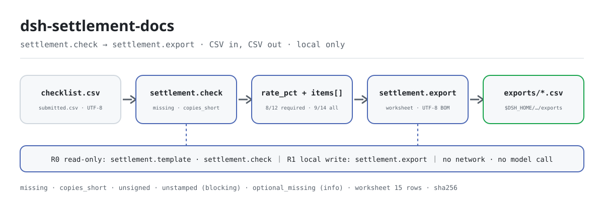
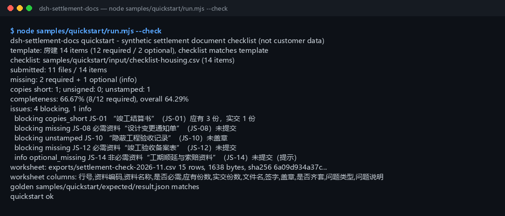

<div align="center">

<picture>
  <source media="(prefers-color-scheme: dark)" srcset="docs/assets/dsh-settlement-docs-flow-dark.svg">
  
</picture>

# dsh-settlement-docs

**按资料清单核对竣工结算资料齐套性：缺件、份数不足、未签字/未盖章、非必需缺失 → 核对表 CSV。**

面向 DeepSeek Harness 的纯本地资料齐套核对工具：读一份资料清单 CSV 和一份实际提交清单 CSV，逐项对齐后给出齐套率，再把问题清单导成 Excel 可直接打开的核对表——只读文件名、份数和签章标记，不读文件内容，不联网、不调用模型、不上传。

[安装](#三步上手) · [配置](#配置) · [FAQ](#faq) · [简体中文](README.md) · [English](README.en.md) · [Español](README.es.md) · [Português](README.pt.md) · [हिन्दी](README.hi.md)

[](LICENSE)
[](#兼容性)
[](https://www.npmjs.com/package/dsh-settlement-docs)
[](https://github.com/PerryLink/dsh-settlement-docs/actions/workflows/ci.yml)
[](#兼容性)

[](https://github.com/PerryLink/dsh-settlement-docs/stargazers)
[](https://www.npmjs.com/package/dsh-settlement-docs)

```sh
dsh plugin --profile <profile> add dsh-settlement-docs
```

</div>

<sub>社区插件，与 DeepSeek 官方无关。唯一仓库：<https://github.com/PerryLink/dsh-settlement-docs>。状态：alpha / 公开合成 / partial / not counted / 非 GA——不含客户数据、客户证据，也不作生产可用声明。</sub>

## 它是什么

把“应该交哪些竣工结算资料”和“实际交了什么”逐项对齐：先列出缺件、份数不足、没签字/没盖章和非必需缺失，再算出一个齐套率，最后导出一份可复核的核对表 CSV——只读 CSV 里的文件名、份数和签章标记，不读文件内容，不联网、不调用模型、不上传。

- **适合**：总包、分包、业主方和监理的结算资料员，在送审或归档前做一次齐套自检；项目类型固定（房建 / 市政 / 装饰），资料清单几十项以内；需要把“缺什么、差几份、谁没签章”一次性交给经办人；需要一份能直接发出去、Excel 打开不乱码的核对表。
- **不适合**：替代档案验收、竣工备案或法律意见；扫描件/PDF/图片的 OCR（只收 CSV，不读文件内容）；判断资料内容是否真实、签字是否有效；多项目、多标段台账（本包一次只核对一个项目的清单）。

## 三步上手

1. **安装**（三选一）：

   ```sh
   # npm 通道（推荐，已发布版本）
   dsh plugin --profile <profile> add dsh-settlement-docs
   # git 通道（最新 main；等价于 git+https://github.com/PerryLink/dsh-settlement-docs.git）
   dsh plugin --profile <profile> add github:PerryLink/dsh-settlement-docs
   # tarball 通道：本仓库 pnpm pack 后
   dsh plugin --profile <profile> add ./dsh-settlement-docs-<version>.tgz
   ```

2. **最小配置**（无需任何 Config 键，`cordis.patch.yml` 只插入这一行）：

   ```yaml
   - insert:
       - id: dsh-settlement-docs
         name: 'dsh-settlement-docs'
   ```

3. **验证已生效**：

   ```sh
   dsh --profile <profile> --dump-config | grep dsh-settlement-docs
   node samples/quickstart/run.mjs --check
   ```

**卸载**：`dsh plugin --profile <profile> remove dsh-settlement-docs`（或从 profile patch 删掉该行）。

## 核心能力

工具名是稳定 API；工具说明保留英文以匹配运行时输出。

| 工具 | 用途 | 风险 |
|---|---|---|
| `settlement.template` | 按工程类型生成内置资料清单模板 CSV（房建 / 市政 / 装饰，各 ≥12 项），返回文本和计数 | R0 |
| `settlement.check` | 核对清单与实际提交：缺件、份数不足、未签字/未盖章、非必需缺失、齐套率 | R0 |
| `settlement.export` | 重跑核对并写核对表 CSV（UTF-8 BOM），返回路径、行数、字节数和 sha256 | R1 本地写 |

- **清单驱动** —— 资料清单和实际提交清单各一份 CSV，按资料编码逐项对齐；编码对不上就停，不会静默把缺件算成已交。
- **四类问题 + 齐套率** —— 缺件、份数不足、未签字、未盖章分别计数；齐套率只统计必需资料，另给含非必需资料的全量完整率。
- **非必需只提示** —— 非必需的资料缺失记 `optional_missing`，不拉低齐套率，但仍列进问题清单和核对表。
- **核对表可复核** —— 一行一条清单资料，问题类型和问题说明都在行内；UTF-8 BOM，Excel 直接打开不乱码，导出结果带 sha256。
- **纯本地** —— 不联网、不调用模型、不上传；源 CSV 只读，永不修改。

## 输入

- **资料清单 CSV**：UTF-8，表头含 `资料编码,资料名称,应有份数,是否必需`。
  - `应有份数` 是正整数；`是否必需` 写 `是/否`（也接受 `必需/非必需`）。
  - 英文表头 `code,name,required_copies,required` 也接受，列顺序随意，多余列忽略。
  - 每个资料编码只能出现一次；清单不能为空（只有表头也会报错）。
- **实际提交清单 CSV**：UTF-8，表头含 `资料编码,文件名,份数,签字,盖章`。
  - `份数` 是非负整数；`签字`/`盖章` 写 `是/否`（也接受 `已签字`、`未盖章`、`true`、`0`，留空按“否”处理）。
  - 每个资料编码只能出现一次；只有表头表示“一份都没交”，这是合法的，齐套率为 0%。
- **工程类型模板**：`房建`（14 项 / 12 必需）、`市政`（13 项 / 12 必需）、`装饰`（12 项 / 11 必需）。
- **样例**：`samples/quickstart/input/checklist-housing.csv`（14 项，与 `settlement.template` 的房建输出逐字节一致）和 `submitted-2026-11.csv`（11 份）。全部为合成数据（虚构编码、文件名和份数）。

## 输出

- `settlement.template`：内置最小资料清单模板 CSV 文本、项目类型、总项数、必需/非必需项数、字节数和 sha256；**不落盘**，需要文件时自行保存或交给导出工具。
- `settlement.check`：`summary`（清单项数、已交数、缺件、份数不足、未签字、未盖章、非必需缺失、齐套率、阻塞/提示数）、按清单顺序排列的 `issues`、逐项合并后的 `items`。
- `settlement.export`：核对表 CSV（UTF-8 BOM，Excel 直接打开不乱码），一行一条清单资料，问题类型和问题说明都在行内；写到 `$DSH_HOME/dsh-settlement-docs/exports/`，返回路径、行数、字节数和 sha256。不传 `filename` 时写 `settlement-check.csv`（同名会覆盖）。
- **不改原 CSV**，不上传、不联网、不调用模型。

### 核对规则

1. **缺件**：必需资料在实际提交清单里没有对应编码 → `missing`，阻塞。
2. **非必需缺失**：非必需资料没交 → `optional_missing`，提示级，不拉低齐套率。
3. **份数不足**：`实交份数 < 应有份数` → `copies_short`；相等或更多都算够。
4. **未签字 / 未盖章**：`签字` 或 `盖章` 为“否/空” → `unsigned` / `unstamped`，同一份可以同时命中两条。
5. **未知编码**：实际提交里出现清单中没有的编码 → `E_SETTLEMENT_UNKNOWN_CODE`，整次核对中止。
6. **重复编码**：任一清单里同一编码出现多次 → `E_SETTLEMENT_DUP_CODE`。
7. **齐套**：已提交 + 份数够 + 已签字 + 已盖章，四项全满足，`items[].complete=true`。
8. **空清单**：资料清单为空或只有表头 → `E_SETTLEMENT_EMPTY`；实际提交只有表头是合法的（= 0 份）。

## 示例

直接复制下面这句发给 agent：

> 帮我把这份竣工结算资料核对一下：缺哪些、份数够不够、有没有没签字的，再把核对表导出来。

用自带样例复跑并核对金标：

```sh
node samples/quickstart/run.mjs --check
```



样例是一次真实运行：房建清单 14 项（12 必需 / 2 非必需），实际提交 11 份；缺 **2 项必需 + 1 项非必需**，**1 项份数不足**（竣工结算书 1/3 份），**1 项未盖章**（隐蔽工程验收记录），没有未签字项。齐套率 **66.67%（8/12 必需）**，全量完整率 **64.29%（9/14）**，**4 个阻塞 + 1 个提示**，核对表 15 行、1,638 字节。金标 `samples/quickstart/expected/result.json` 由 `node samples/quickstart/run.mjs --json` 真实产生，不是手写；原始日志见 [`docs/assets/quickstart.log`](docs/assets/quickstart.log)。

## 配置

本插件**没有 Config 键**——挂载后即全部可用，所有可调项都在三个工具的调用参数上：

| 工具 | 参数 | 必填 | 含义 |
|---|---|---|---|
| `settlement.template` | `project_type` | 是 | 工程类型：`房建`、`市政`、`装饰`（英文 `housing`/`municipal`/`decoration` 也接受） |
| `settlement.check` | `checklist_csv` | 是 | 资料清单 CSV 的文本内容（工具面直接传文件内容） |
| `settlement.check` | `submission_csv` | 是 | 实际提交清单 CSV 的文本内容 |
| `settlement.export` | `checklist_csv` | 是 | 同上 |
| `settlement.export` | `submission_csv` | 是 | 同上 |
| `settlement.export` | `filename` | 否 | 导出文件名，只允许 `[A-Za-z0-9._-]`、最长 120 字符；默认 `settlement-check.csv` |

调用示例（工具面）：

```sh
# 1) 生成模板（工具面）
#    settlement.template({ project_type: "房建" })

# 2) 核对（工具面）
#    settlement.check({ checklist_csv, submission_csv })

# 3) 导出核对表（工具面）
#    settlement.export({ checklist_csv, submission_csv, filename: "settlement-check-2026-11.csv" })
```

测试可用环境变量 `DSH_SETTLEMENT_DOCS_HOME` 覆盖本地写根目录；默认严格等于 `$DSH_HOME/dsh-settlement-docs`。

## FAQ

<details>
<summary>齐套率到底怎么算？</summary>

**齐套率 = 完整齐套的必需资料数 ÷ 必需资料总数**，保留 2 位小数。一份资料只有“已提交、份数够、已签字、已盖章”四项都满足才算完整。`summary.overall_rate_pct` 是含非必需资料的全量完整率，两者会不一样，核对表里逐项都有 `是否齐套`。

</details>

<details>
<summary>非必需资料缺失为什么不阻塞？</summary>

“非必需”表示缺了也能送审，所以只出提示级问题、不拉低齐套率，但会列在 `issues` 和核对表的 `问题类型=optional_missing` 里，方便你决定要不要补。已经提交的非必需资料如果份数或签章有问题，也会列出（同样提示级）。

</details>

<details>
<summary>为什么实际提交清单里出现未知编码会直接报错？</summary>

编码对不上时，如果静默忽略，齐套率会被算高——比如把 `JS-08` 误写成 `JS-09`，系统会认为 `JS-08` 缺件却把 `JS-09` 算成已交。所以 `E_SETTLEMENT_UNKNOWN_CODE` 会拦下整次核对，并列出所有未知编码，核对完再跑。资料清单里出现重复编码同理（`E_SETTLEMENT_DUP_CODE`）。

</details>

<details>
<summary>签字或盖章留空会怎样？</summary>

留空按“否”处理，和显式写“否”一样会报未签字/未盖章。**但列不能整列缺失**——少了 `签字` 或 `盖章` 列会报 `E_SETTLEMENT_CSV_ROW`，因为那通常意味着表头复制错了。

</details>

<details>
<summary>会改我的 CSV 或上传数据吗？能直接读 Excel 吗？</summary>

不会改、不会上传、不联网。只收 CSV；Excel 请先“另存为 → CSV UTF-8”。Excel 保存的 UTF-8 CSV 通常带 BOM，本包能正确识别。

</details>

<details>
<summary>内置模板能直接当正式清单用吗？</summary>

不能直接当法定清单。它是**最小可用起点**（房建 14 项、市政 13 项、装饰 12 项），覆盖结算送审最常见的资料；各地备案、专项验收和合同约定还会追加资料。请以合同和当地档案要求为准，把模板当核对骨架。

</details>

## 权限

读：用户指定的资料清单 CSV 和实际提交清单 CSV（样例 `samples/quickstart/input/`）；不读其他目录。
写：`$DSH_HOME/dsh-settlement-docs/exports/`（核对表 CSV）；不改原文件。
联网：否。
外部系统：无。

`settlement.template`、`settlement.check` 标 **R0**（只读，模板只在内存里生成）；`settlement.export` 标 **R1**（本地写，只写 `$DSH_HOME/dsh-settlement-docs` 下的 `exports/`）。可用 `DSH_SETTLEMENT_DOCS_HOME` 覆盖本地写根目录（测试用），默认严格等于 `$DSH_HOME/dsh-settlement-docs`。

## 验收证据

公开/合成 fixture 在 `samples/quickstart/`；`ACCEPTANCE.csv` 记录检查，除 quickstart 行外均为 `counted=false`。

| req_id | metric | threshold | actual | pass | source | counted |
|---|---|---|---|---|---|---|
| SD-A05 | 缺件 | 2 必需 + 1 非必需 | required=2 optional=1 | true | public/synthetic | false |
| SD-A08 | 齐套率 | 66.67% (8/12) | 66.67% (8/12) | true | public/synthetic | false |
| PS1-QS01 | quickstart 金标 | 1/1 | 1 | true | synthetic/quickstart | true |

*这是 fixture 支撑的验收行，不是客户运行；没有编造输出。*

## 边界与已知限制

- **只核对齐套，不核对内容**：不判断结算书金额、签证是否成立、签字人权限或资料真伪。
- **一份资料一行**：同一编码拆成多个文件时请先合并或改成一个条目；重复编码会报 `E_SETTLEMENT_DUP_CODE`。
- **不读 PDF/图片**：只看 CSV 里的文件名、份数和签章标记，不做 OCR。
- **模板不是法定清单**：以合同和当地备案要求为准，模板只是最小起点。
- **单项目单标段**：一次核对一个项目的清单；多标段请拆成多份清单。
- 仅公开/合成样例；alpha/partial、not counted，不作 GA 或生产可用声明。

## 兼容性

| 维度 | 状态 |
|---|---|
| Harness | `dsh >=0.2.1-rc.3 <0.4.0` |
| Node | `>=24.9.0 <25` |
| 平台 | 全平台；仅本地文件 |
| 数据 | 不联网、不调用模型、不上传 |

## 生态与质量

- [npm 包页](https://www.npmjs.com/package/dsh-settlement-docs)（版本与下载量）
- [CI 工作流](https://github.com/PerryLink/dsh-settlement-docs/actions/workflows/ci.yml)（`ci.yml`：构建、lint、类型检查、测试、验收门）
- [故障排查](TROUBLESHOOTING.md)（按「症状 / 原因 / 动作」写的 5 个错误码排查）
- [生态实测知识库](https://perrylink.github.io/dsh-plugin-guide/)：插件开发指南 · 选型实测数据 · 维护取舍判据

## 相关项目

- [dsh-progress-payment](https://github.com/PerryLink/dsh-progress-payment)（按合同基准确认进度款）
- [dsh-contract-pack](https://github.com/PerryLink/dsh-contract-pack)（合同条款与台账）
- [dsh-construction-pack](https://github.com/PerryLink/dsh-construction-pack)（房建场景工具组合）

## 开发

```sh
pnpm install --frozen-lockfile
pnpm build && pnpm lint && pnpm typecheck
node --test test/*.test.mjs
node scripts/gate.mjs
```

当前版本 `0.1.0`，72 项测试通过（`node --test test/*.test.mjs`）。发布门禁 `node scripts/gate.mjs` = 元数据 lint + 公开验收行全过 + quickstart 金标行存在。开头流程图由 [`scripts/gen-readme-assets.py`](scripts/gen-readme-assets.py) 程序化生成（Python + Pillow，纯 SVG、命令 token 文案、深浅双版；没有 benchmark 数据，所以不生成 evidence 图），可重复执行；`docs/assets/quickstart.png` 为真实运行截图，配合 `docs/assets/quickstart.log` 保留。

Topics：`dsh`、`dsh-plugin`、`deepseek-harness`、`settlement`、`completion-documents`、`construction`、`document-checklist`、`csv`、`perrylink`

## 家族与致谢

本项目是 [PerryLink](https://github.com/PerryLink) 维护的 DeepSeek Harness 插件家族成员（全部 Apache-2.0）。如果这个插件帮到了你，**给个 star**——它不解锁任何功能，但会让下一个人更容易找到它。

- [@PerryLink](https://github.com/PerryLink) —— 创建者与维护者：竣工结算资料核对引擎、CSV 解析与齐套率、三个工具面、quickstart 金标样例、故障排查文档与五语文档。

## License

[LICENSE](LICENSE)（Apache License 2.0）© 2026 dsh-settlement-docs contributors。另见 `NOTICE`、`THIRD-PARTY-NOTICES`。

<p align="center"><sub>Apache-2.0 · 社区插件，与 DeepSeek 无关。</sub></p>
