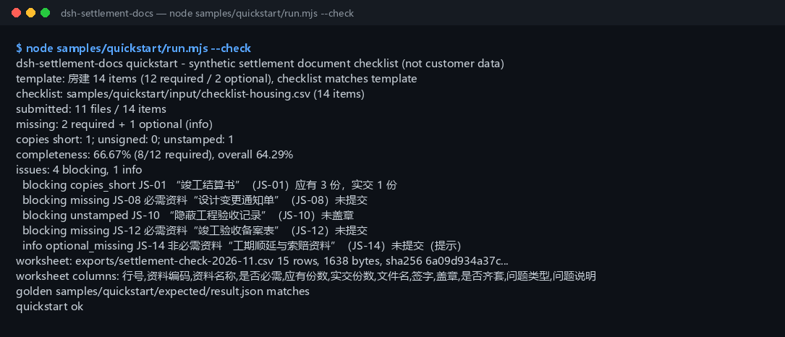

<div align="center">

<picture>
  <source media="(prefers-color-scheme: dark)" srcset="docs/assets/dsh-settlement-docs-hero-en-dark.webp">
  
</picture>

# dsh-settlement-docs

**Confere uma lista de documentos de liquidação final de obra com o que foi realmente entregue: documentos ausentes, cópias insuficientes, assinaturas/carimbos ausentes, documentos opcionais não entregues → CSV de planilha de revisão.**

Uma ferramenta de verificação de completude puramente local para o DeepSeek Harness: lê um CSV de lista de documentos e um CSV de entrega real, alinha os dois item a item, calcula a taxa de completude e exporta uma planilha de revisão que abre limpa no Excel — apenas nomes de arquivo, número de cópias e marcas de assinatura/carimbo; não lê o conteúdo dos arquivos e não envia, não acessa a rede nem chama um modelo.

[Instalar](#instalação-em-três-passos) · [Configuração](#configuração) · [FAQ](#faq) · [简体中文](README.md) · [English](README.en.md) · [Español](README.es.md) · [Português](README.pt.md) · [हिन्दी](README.hi.md)

[](LICENSE)
[](#compatibilidade)
[](https://www.npmjs.com/package/dsh-settlement-docs)
[](https://github.com/PerryLink/dsh-settlement-docs/actions/workflows/ci.yml)
[](#compatibilidade)

[](https://github.com/PerryLink/dsh-settlement-docs/stargazers)
[](https://www.npmjs.com/package/dsh-settlement-docs)

```sh
dsh plugin --profile <profile> add dsh-settlement-docs
```

</div>

<sub>Plugin da comunidade, sem afiliação com a DeepSeek. Repositório canônico: <https://github.com/PerryLink/dsh-settlement-docs>. Estado: alpha / público-sintético / partial / not counted / não GA — sem dados de clientes, sem evidência de clientes e sem declaração de prontidão para produção.</sub>

## O que é

Alinha “quais documentos de liquidação final deveriam ter sido entregues” com “o que realmente chegou”: lista documentos ausentes, cópias insuficientes, assinaturas/carimbos ausentes e documentos opcionais não entregues, calcula uma taxa de completude e exporta uma planilha de revisão CSV — lê apenas nomes de arquivo, número de cópias e marcas de assinatura/carimbo do CSV, nunca o conteúdo dos arquivos, e não envia, não acessa a rede nem chama um modelo.

- **Serve:** responsáveis pela documentação de liquidação em contratada principal, subcontratada, proprietário ou fiscalização fazendo uma autoconferência de completude antes de entregar; um tipo de obra fixo (residencial / municipal / decoração) com uma lista de dezenas de itens; precisar de uma única lista do que falta, quantas cópias faltam e qual carimbo está ausente; precisar de uma planilha que abra limpa no Excel.
- **Não serve:** substituir aceitação de arquivo, registro de conclusão ou parecer jurídico; OCR de PDF/escaneados/imagens (somente CSV, o conteúdo nunca é lido); julgar se um documento é autêntico ou se uma assinatura é autorizada; livros de vários projetos ou seções (uma lista por execução).

<picture>
  <source media="(prefers-color-scheme: dark)" srcset="docs/assets/dsh-settlement-docs-flow-v5-dark.svg">
  
</picture>

## Instalação em três passos

1. **Instalar** (escolha um canal):

   ```sh
   # canal npm (recomendado, versões publicadas)
   dsh plugin --profile <profile> add dsh-settlement-docs
   # canal git (main mais recente; equivale a git+https://github.com/PerryLink/dsh-settlement-docs.git)
   dsh plugin --profile <profile> add github:PerryLink/dsh-settlement-docs
   # canal tarball: pnpm pack neste repo e depois
   dsh plugin --profile <profile> add ./dsh-settlement-docs-<version>.tgz
   ```

2. **Configuração mínima** (não há nenhuma chave Config; o `cordis.patch.yml` só insere esta linha):

   ```yaml
   - insert:
       - id: dsh-settlement-docs
         name: 'dsh-settlement-docs'
   ```

3. **Verificar que monta**:

   ```sh
   dsh --profile <profile> --dump-config | grep dsh-settlement-docs
   node samples/quickstart/run.mjs --check
   ```

**Desinstalar**: `dsh plugin --profile <profile> remove dsh-settlement-docs` (ou remova a linha do patch do perfil).

## Capacidades principais

Os nomes das ferramentas são API estável; as descrições ficam em inglês para coincidir com a saída do runtime.

| Ferramenta | Uso | Risco |
|---|---|---|
| `settlement.template` | Gera o CSV de modelo de lista embutido para um tipo de obra (residencial / municipal / decoração, 12+ itens cada); devolve texto e contagens | R0 |
| `settlement.check` | Compara lista e entrega: ausentes, cópias insuficientes, assinatura/carimbo ausentes, opcionais não entregues, taxa de completude | R0 |
| `settlement.export` | Repete a conferência e grava o CSV da planilha de revisão (UTF-8 BOM); devolve caminho, linhas, bytes e sha256 | R1 gravação local |

- **Guiado pela lista** — um CSV de lista e um CSV de entrega são alinhados por código de documento; um código que não coincide interrompe a execução em vez de contar em silêncio um documento ausente como entregue.
- **Quatro tipos de problema + taxa** — ausentes, cópias insuficientes, sem assinatura e sem carimbo são contados separadamente; a taxa exigida cobre apenas documentos obrigatórios, e uma segunda taxa global inclui os opcionais.
- **Opcionais nunca bloqueiam** — um documento opcional ausente vira `optional_missing`, não baixa a taxa exigida e ainda aparece na lista de problemas e na planilha.
- **Planilha revisável** — uma linha por item com tipo e mensagem do problema; UTF-8 BOM para o Excel abrir limpo, e o resultado da exportação traz sha256.
- **Puramente local** — sem rede, sem chamada ao modelo, sem envio; os CSVs de origem são somente leitura e nunca são modificados.

## Entrada

- **CSV da lista de documentos:** UTF-8, cabeçalho `code,name,required_copies,required` (os nomes de coluna equivalentes em chinês também são aceitos). A ordem das colunas é livre e colunas extras são ignoradas.
  - `required_copies` é um inteiro positivo; `required` é sim/não (os marcadores chineses também são aceitos).
  - Cada código de documento aparece uma vez; a lista não pode estar vazia (somente cabeçalho também é rejeitado).
- **CSV de entrega real:** UTF-8, cabeçalho `code,filename,copies,signed,stamped` (o cabeçalho chinês também é aceito).
  - `copies` é um inteiro não negativo; `signed`/`stamped` são sim/não (também aceita vários marcadores chineses, `true`, `0`; célula em branco significa “não”).
  - Cada código aparece uma vez. Um arquivo só com cabeçalho significa “nada foi entregue” e é válido (0% de completude).
- **Modelos de tipo de obra:** residencial (14 itens / 12 obrigatórios), municipal (13 / 12), decoração (12 / 11).
- **Amostra:** `samples/quickstart/input/checklist-housing.csv` (14 itens, idêntico byte a byte ao modelo residencial) e `submitted-2026-11.csv` (11 arquivos). Apenas sintéticos (códigos, nomes de arquivo e cópias inventados).

## Saída

- `settlement.template`: texto CSV do modelo de lista embutido, tipo de obra, total de itens, obrigatórios/opcionais, bytes e sha256. **Nenhum arquivo é gravado.**
- `settlement.check`: `summary` (itens da lista, entregues, ausentes, cópias insuficientes, sem assinatura, sem carimbo, opcionais ausentes, taxa de completude, contagens de bloqueio/info), uma lista `issues` na ordem da lista e `items` mesclados por item.
- `settlement.export`: CSV da planilha de revisão (UTF-8 BOM, abre limpo no Excel), uma linha por item com tipo e mensagem do problema; gravado em `$DSH_HOME/dsh-settlement-docs/exports/`; devolve caminho, linhas, bytes e sha256. Sem `filename`, grava `settlement-check.csv` (arquivos com o mesmo nome são sobrescritos).
- Os CSVs de origem nunca são modificados; sem envio, sem rede, sem chamada ao modelo.

### Regras de verificação

1. **Ausente obrigatório** — um código obrigatório ausente na entrega → `missing`, bloqueante.
2. **Opcional ausente** — um código opcional ausente → `optional_missing`, apenas informativo; não baixa a taxa exigida.
3. **Cópias insuficientes** — `entregues < exigidas` → `copies_short`; igual ou mais está bom.
4. **Sem assinatura / sem carimbo** — `signed` ou `stamped` é “não”/vazio → `unsigned` / `unstamped`; o mesmo item pode ter os dois.
5. **Código desconhecido** — um código entregue que não está na lista → `E_SETTLEMENT_UNKNOWN_CODE`; toda a conferência para.
6. **Código duplicado** — o mesmo código duas vezes em qualquer uma das listas → `E_SETTLEMENT_DUP_CODE`.
7. **Completo** — entregue + cópias suficientes + assinado + carimbado; `items[].complete=true` só então.
8. **Lista vazia** — vazia ou só com cabeçalho → `E_SETTLEMENT_EMPTY`. Uma entrega só com cabeçalho é válida (= nada entregue).

## Exemplo

Cole esta linha no agente:

```text
帮我把这份竣工结算资料核对一下：缺哪些、份数够不够、有没有没签字的，再把核对表导出来。
```

Reproduza a amostra incluída e compare com o arquivo dourado:

```sh
node samples/quickstart/run.mjs --check
```



É uma execução real: lista residencial de 14 itens (12 obrigatórios / 2 opcionais) contra 11 arquivos entregues — **2 obrigatórios + 1 opcional ausentes**, **1 cópia insuficiente** (livro de liquidação 1/3), **1 carimbo ausente** (registro de obras ocultas), nenhuma assinatura ausente. A taxa de completude é **66,67% (8/12 obrigatórios)** e **64,29% (9/14) global**, com **4 bloqueantes + 1 informativo** e uma planilha de 15 linhas (1.638 bytes). `samples/quickstart/expected/result.json` é a saída real de `node samples/quickstart/run.mjs --json`, não escrita à mão; o log bruto está em [`docs/assets/quickstart.log`](docs/assets/quickstart.log).

## Configuração

Este plugin **não tem chaves Config** — fica totalmente utilizável ao ser montado, e tudo o que é ajustável está nos argumentos de chamada das três ferramentas:

| Ferramenta | Parâmetro | Obrigatório | Significado |
|---|---|---|---|
| `settlement.template` | `project_type` | sim | Tipo de obra: `housing`, `municipal` ou `decoration` (os nomes chineses também são aceitos) |
| `settlement.check` | `checklist_csv` | sim | Texto do CSV da lista (a superfície de ferramenta recebe o conteúdo do arquivo) |
| `settlement.check` | `submission_csv` | sim | Texto do CSV de entrega real |
| `settlement.export` | `checklist_csv` | sim | Igual acima |
| `settlement.export` | `submission_csv` | sim | Igual acima |
| `settlement.export` | `filename` | não | Nome do arquivo de exportação, apenas `[A-Za-z0-9._-]`, no máximo 120 caracteres; padrão `settlement-check.csv` |

Exemplo de chamada (superfície de ferramenta):

```sh
# 1) gerar um modelo (superfície de ferramenta)
#    settlement.template({ project_type: "housing" })

# 2) conferir (superfície de ferramenta)
#    settlement.check({ checklist_csv, submission_csv })

# 3) exportar a planilha (superfície de ferramenta)
#    settlement.export({ checklist_csv, submission_csv, filename: "settlement-check-2026-11.csv" })
```

Para testes, a variável de ambiente `DSH_SETTLEMENT_DOCS_HOME` sobrescreve a raiz de gravação local; por padrão é exatamente `$DSH_HOME/dsh-settlement-docs`.

## FAQ

<details>
<summary>Como a taxa de completude é calculada?</summary>

**Taxa = documentos obrigatórios completos ÷ total de documentos obrigatórios**, arredondada em 2 casas. Um documento só está completo quando foi entregue, tem cópias suficientes, está assinado e está carimbado. `summary.overall_rate_pct` é o mesmo cálculo incluindo os opcionais; a planilha tem uma coluna de completude por linha.

</details>

<details>
<summary>Por que um documento opcional ausente não bloqueia?</summary>

“Opcional” significa que pode faltar na entrega, então gera um problema informativo e não baixa a taxa exigida; mesmo assim aparece em `issues` e na planilha como `optional_missing`. Um documento opcional entregue com defeito de cópias/assinatura/carimbo também é informado no nível informativo.

</details>

<details>
<summary>Por que um código desconhecido aborta a conferência?</summary>

Ignorar em silêncio um código que não coincide inflaria a taxa — um erro de digitação de `JS-08` como `JS-09` marcaria `JS-09` como recebido enquanto `JS-08` continuaria faltando. `E_SETTLEMENT_UNKNOWN_CODE` para a execução e lista todos os códigos desconhecidos. Um código duplicado em qualquer uma das listas é `E_SETTLEMENT_DUP_CODE`.

</details>

<details>
<summary>O que acontece se a célula de assinatura ou carimbo estiver vazia?</summary>

Uma célula vazia significa “não” e gera o mesmo problema que um não explícito. **A coluna não pode faltar**: um cabeçalho `signed` ou `stamped` ausente é `E_SETTLEMENT_CSV_ROW`, porque normalmente significa que o cabeçalho foi copiado errado.

</details>

<details>
<summary>Ele modifica ou envia meu CSV? Consegue ler Excel diretamente?</summary>

Nunca modifica, envia ou transmite o CSV pela rede. Salve primeiro a planilha como **CSV UTF-8**. CSVs UTF-8 com BOM gravados pelo Excel são aceitos.

</details>

<details>
<summary>Posso usar o modelo embutido como lista oficial?</summary>

Não como registro legal. É um **ponto de partida mínimo** (residencial 14, municipal 13, decoração 12) que cobre os documentos de entrega de liquidação mais comuns; o registro local, a aceitação especial e os requisitos contratuais costumam acrescentar mais. Trate-o como esqueleto e siga o contrato e as normas de arquivo locais.

</details>

## Permissões

Leitura: os CSVs de lista e de entrega indicados pelo usuário (amostra: `samples/quickstart/input/`); nada além disso.
Gravação: apenas `$DSH_HOME/dsh-settlement-docs/exports/` (CSV da planilha de revisão); os arquivos de origem não são modificados.
Rede: não.
Sistemas externos: nenhum.

`settlement.template` e `settlement.check` são **R0** (somente leitura; o modelo vive na memória). `settlement.export` é **R1** (gravação local em `$DSH_HOME/dsh-settlement-docs`). `DSH_SETTLEMENT_DOCS_HOME` pode sobrescrever a raiz de gravação local para testes; por padrão é exatamente `$DSH_HOME/dsh-settlement-docs`.

## Evidência de aceitação

Os fixtures públicos/sintéticos ficam em `samples/quickstart/`; o `ACCEPTANCE.csv` registra as verificações e todas as linhas exceto a do quickstart são `counted=false`.

| req_id | metric | threshold | actual | pass | source | counted |
|---|---|---|---|---|---|---|
| SD-A05 | documentos ausentes | 2 obrigatórios + 1 opcional | required=2 optional=1 | true | public/synthetic | false |
| SD-A08 | taxa de completude | 66,67% (8/12) | 66,67% (8/12) | true | public/synthetic | false |
| PS1-QS01 | dourado do quickstart | 1/1 | 1 | true | synthetic/quickstart | true |

*Linhas de aceitação respaldadas por fixtures, não uma execução de cliente; nenhuma saída foi inventada.*

## Limites e restrições conhecidas

- **Só completude, não conteúdo**: não verifica valores, se uma variação é válida, a autoridade do signatário ou a autenticidade do documento.
- **Uma linha por documento**: mescle arquivos divididos em um único código; códigos duplicados falham com `E_SETTLEMENT_DUP_CODE`.
- **Sem leitura de PDF/imagens**: apenas nome de arquivo, número de cópias e marcas de assinatura/carimbo no CSV; sem OCR.
- **O modelo não é um registro legal**: siga o contrato e os requisitos de arquivo locais.
- **Um projeto/seção por execução**: divida projetos com várias seções em listas separadas.
- Apenas fixtures públicos/sintéticos; alpha/partial, not counted, sem declaração de GA ou de prontidão para produção.

## Compatibilidade

| Dimensão | Estado |
|---|---|
| Harness | `dsh >=0.2.1-rc.3 <0.4.0` |
| Node | `>=24.9.0 <25` |
| Plataformas | Todas; apenas arquivos locais |
| Dados | Sem rede, sem chamada ao modelo, sem envio |

## Ecossistema e qualidade

- [Página do pacote npm](https://www.npmjs.com/package/dsh-settlement-docs) (versão e downloads)
- [Workflow de CI](https://github.com/PerryLink/dsh-settlement-docs/actions/workflows/ci.yml) (`ci.yml`: build, lint, typecheck, testes, portão de aceitação)
- [Solução de problemas](TROUBLESHOOTING.md) (5 códigos de erro escritos como sintoma / causa / ação)
- [Base de conhecimento do ecossistema](https://perrylink.github.io/dsh-plugin-guide/): guia de desenvolvimento de plugins · dados de seleção · critérios de manutenção

## Projetos relacionados

- [dsh-progress-payment](https://github.com/PerryLink/dsh-progress-payment) (pagamento por avanço com base contratual)
- [dsh-contract-pack](https://github.com/PerryLink/dsh-contract-pack) (cláusulas e registros de contrato)
- [dsh-construction-pack](https://github.com/PerryLink/dsh-construction-pack) (pacote de cenários de construção)

## Desenvolvimento

```sh
pnpm install --frozen-lockfile
pnpm build && pnpm lint && pnpm typecheck
node --test test/*.test.mjs
node scripts/gate.mjs
```

Versão atual `0.1.0`, 72 testes passando (`node --test test/*.test.mjs`). O portão de publicação `node scripts/gate.mjs` = lint de metadados + todas as linhas públicas de aceitação passando + a linha dourada do quickstart presente. O banner inicial e o diagrama de estrutura são gerados por [`scripts/gen-readme-assets.py`](scripts/gen-readme-assets.py) (Pillow produz o webp claro/escuro de 1440×576, um SVG escrito à mão produz o diagrama de 1100×660; cada número é copiado de `samples/quickstart/expected/result.json`; não há dados de benchmark, então nenhum gráfico de evidência é emitido) e pode ser executado de novo; `docs/assets/quickstart.png` é uma captura real mantida junto com `docs/assets/quickstart.log`.

Topics: `dsh`, `dsh-plugin`, `deepseek-harness`, `settlement`, `completion-documents`, `construction`, `document-checklist`, `csv`, `perrylink`

## Família e agradecimentos

Este projeto faz parte da família de plugins DeepSeek Harness da [PerryLink](https://github.com/PerryLink) (todos Apache-2.0). Se ele for útil, **uma estrela ajuda a próxima pessoa a encontrá-lo** — nada é desbloqueado por isso.

- [@PerryLink](https://github.com/PerryLink) — criador e mantenedor: o motor de conferência de documentos de liquidação, a análise CSV e a taxa de completude, as três superfícies de ferramenta, a amostra dourada do quickstart, o guia de solução de problemas e a documentação em cinco idiomas.

## Licença

[LICENSE](LICENSE) (Apache License 2.0) © 2026 dsh-settlement-docs contributors. Veja também `NOTICE` e `THIRD-PARTY-NOTICES`.

<p align="center"><sub>Apache-2.0 · Plugin da comunidade, sem afiliação com a DeepSeek.</sub></p>
